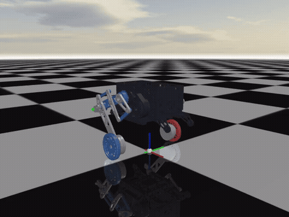

# 轮腿机器人仿真：Circleg 与 GBC486

这个仓库包含两个独立的轮腿机器人 MuJoCo 仿真项目：

| 项目 | 构型 | 控制栈 | 状态 |
|---|---|---|---|
| [`circleg/`](circleg/) | 偏心曲柄轮圈腿 | LQR + 8 状态 MPC + WBC | 代码已迁入，文档与视频整理中 |
| [`gbc486/`](gbc486/) | 五连杆串联腿 | 8 状态 MPC + WLS 全身控制 + 双质量块跳跃 | 代码、文档、四个测试视频完成 |

两个项目各自带 `Algorithm/`、模型、测试、文档和视频，互不 import。它们最初在同一个工作区开发，串腿早期复用过 circleg 的算法层；后来发现两套部署的模型和任务差异无法共用，已经拆成两份独立副本。



## 项目一：GBC486 串联腿

`gbc486/` 是五连杆串联腿轮腿机器人。每条腿两个髋部电机经双平行四边形驱动大腿和小腿，轮毂电机直驱轮子。控制栈为 50 Hz 的 8 状态 MPC 加 250 Hz 的 WLS 全身控制，跳跃采用双质量块规划。

四个测试工况都录了视频：

| 工况 | 结果 | 视频 |
|---|---|---|
| 前行 | 0→1.5 m/s，4.0 s 停稳，里程 4.25 m，max\|pitch\| 0.08° | [mp4](gbc486/videos/serial_forward_50fps.mp4) |
| 原地转圈 | 1.5 rad/s，4.2 s 转约 353°，纵向漂移 0.10 m | [mp4](gbc486/videos/serial_spin_50fps.mp4) |
| 原地跳跃 | 轮离地 222 mm，落地后 0.67 s 进入稳态，max\|pitch\| 11.7° | [mp4](gbc486/videos/serial_jump_50fps.mp4) |
| 前进+跳跃 | 1.0 m/s 行进中起跳，轮离地 221 mm，max\|pitch\| 11.3° | [mp4](gbc486/videos/serial_forward_jump_50fps.mp4) |

文档入口：[`gbc486/README.md`](gbc486/README.md)。包括架构、MPC/WBC、跳跃、调试复盘、测试复现五份文档。

## 项目二：Circleg 轮圈腿

`circleg/` 是偏心曲柄式轮圈腿。每条腿一个髋关节通过 60 mm 曲柄把轮心挂在髋轴上，机身在轮圈内部升降。项目保留两条控制路径：

- LQR：`circleg/main.py`，固定/可调腿长的平衡与速度控制；
- MPC + WBC：`circleg/APP/mujoco_mpc_wbc.py`，8 状态模型、ZMP 参考和 WLS/零空间求解器。

当前实测（默认 `hip_input` + `tuned-fast-accel` + QP）：

| 工况 | 结果 |
|---|---|
| 前行 1.5 m/s | 稳态 1.50 m/s，max\|pitch\| 0.263 rad |
| 原地转圈 1.5 rad/s | 峰值 1.519 rad/s，约一整圈，max\|pitch\| 0.0002 rad |
| 原地跳跃 | 能完整起跳/落地，max\|pitch\| 0.627 rad |
| 前进+跳跃 1.0 m/s | 能跑完，max\|pitch\| 0.625 rad |

轮圈腿的跳跃仍是早期的单质量/腿长方案，姿态指标明显弱于串腿，文档和视频还在整理。详细设计见 [`circleg/docs/reference/轮圈腿技术文档.md`](circleg/docs/reference/轮圈腿技术文档.md) 与 [`circleg/docs/reference/构型与控制逻辑.md`](circleg/docs/reference/构型与控制逻辑.md)。

## 快速开始

环境：Python 3.10 及以上，Windows 或 Linux。两个项目共用根目录的 `.venv`，也可以各自建虚拟环境。

```powershell
python -m venv .venv
.venv\Scripts\activate
python -m pip install -r gbc486/requirements.txt
python -m pip install -r circleg/requirements.txt
```

### GBC486

```powershell
cd gbc486
python tools/view.py                       # 交互仿真
python tools/jump_diagnostic.py --help     # 无界面诊断
python tools/video.py --help               # 离线录像
```

### Circleg

```powershell
cd circleg
python main.py --terrain plane             # LQR 交互仿真
python -m APP.mujoco_mpc_wbc --duration 10 --terrain plane   # MPC/WBC 无界面
python -m APP.mujoco_mpc_wbc --viewer      # MPC/WBC 交互
```

## 目录结构

```text
.
├── circleg/                 轮圈腿项目（自包含）
│   ├── Algorithm/           算法库副本
│   ├── APP/                 应用层、LQR 与 MPC/WBC 入口
│   ├── URDF_Model/          MJCF 模型、网格、场地
│   ├── tests/               单元与回归测试
│   ├── docs/                设计文档与参考资料
│   └── main.py              LQR 入口
├── gbc486/                  串联腿项目（自包含）
│   ├── Algorithm/           算法库副本
│   ├── gbc_mpc_wbc/         GBC486 适配层、MPC/WBC、跳跃
│   ├── MJCF/                模型与网格
│   ├── tools/               查看器、诊断、录像、绘图
│   ├── results/             关键工况记录
│   ├── docs/                文档与图表
│   └── videos/              四个测试视频
├── LICENSE
└── README.md
```

## 开发约定

- 两个项目都不依赖对方的代码。修改其中一个的 `Algorithm/` 不会影响另一个。
- 所有控制参数改动都要有依据，并重新跑对应工况的回归；不能为了让单个指标好看而调参。
- 跳跃相关分析以两个质量块的状态为规划对象，腿长和摆角只作为导出量。
- 评价工具先自检字段、单位、符号和重复性，再用于判断算法。

## 许可证

本项目采用 [PolyForm Noncommercial License 1.0.0](LICENSE)，仅限个人学习、学术研究与技术交流。

控制栈的早期版本来自 CirclegRobot 工作区。两个项目现在各自维护自己的算法副本；历史调试记录保留在各自的 `docs/reference/` 下。
