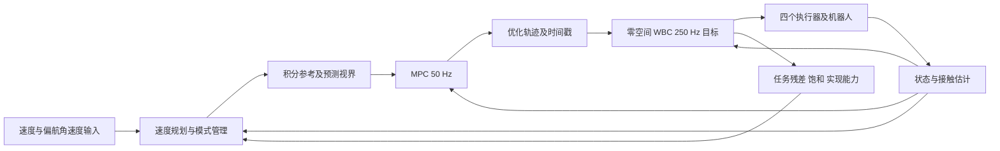

# 速度指令与积分参考方案（算法替换已批准，仿真接入待单独审批）

> 提案日期：2026-09-20；状态更新：2026-09-22。
> 用户已批准速度规划、持久位置积分及状态管理的算法替换。
> 最新边界：先验证算法可行性，不调参；提交结果并获用户单独批准后才能接入仿真。
> 用户进一步确认：位置存在小残差且无持续增长时，暂不要求固定时间内达到 10 mm。
> 文件名保留“待审批”以兼容旧链接；当前待审批对象是后续仿真接入。

## 1. 文献依据与适用边界

来源：项目根目录《【RM2026-串联腿步兵底盘控制系统设计与实现开源】同济大学SuperPower战队.pdf》。
以下页码为 PDF 文件页序，共 21 页。已用工作区内的 pypdf 提取并阅读文本；复杂矩阵的抽取顺序存在错位，
不据此复制矩阵系数。下列结论由相应正文与可识别公式共同支持。

| 原文位置 | 原文描述 | 本项目拟采用的部分 |
|---|---|---|
| p.9，§4.4 | 匀速直立不要求目标位移为零，目标位移按目标速度积分 | 移动位置参考与速度参考同时存在 |
| p.14，§7.1 | 输入纵向速度、偏航角速度和腿长；独立加减速限制的斜坡规划，然后积分位置与航向 | 速度作为正常驾驶唯一纵向命令；先规划再积分 |
| p.11，§5.4 | 位移误差限幅；角度使用环形差；离地时门控地面运动反馈，落地重新对齐积分目标 | 有界位移误差、接触状态门控、事件触发对齐 |
| p.12，§6.1 | 车速应补偿摆腿、伸缩腿造成的轮体相对运动 | 用本机构的雅可比重构速度，不能仅取原始轮速均值 |
| p.13～14，§6.4～6.5 | 打滑判定；只抑制扩大滑移的力矩；接触判定采用滞回 | 规划限速和状态管理参考；不在 WBC 输出之后随意改写力矩 |
| p.15，§7.2 | 自旋关闭偏航位置项；移动时可关闭位移保持；先制动再进入高速自旋 | 普通驾驶与特殊旋转模式使用不同参考策略；首阶段不实现高速自旋 |
| p.18，§8.3～8.4 | 平衡优先于纵向/转向性能；软分配部分尚未接管实际输出 | WBC 的实现能力应反馈上层，区分已生效与待接入功能 |
| p.19～20，§9.1～9.2 | 模式切换第一帧对齐规划器、位置和计时器；起立时不追历史位移 | 事件式重置，避免恢复时追赶旧目标 |

原文主架构是十状态变构型 LQR、腿部 VMC、独立轴向力控制，§7.5 是短时预测误差补偿，
不是滚动优化 MPC。文中 §2～3 使用五连杆闭链运动学，与本项目偏心曲柄轮圈腿不同。
本提案借鉴参考生成和模式管理，不复制其动力学矩阵、VMC 雅可比、腿摆补偿公式或控制增益。
文中“速度项一般不做积分”不能理解成禁止生成位置参考：这里不增加速度误差 PI 积分器，
但仍按 §7.1 积分规划后的速度指令。

## 2. 当前代码与新提案的差别

当前 `VelocityPlanner` 将每个视界的位置起点重新放在实测位置上，内部保留规划器速度/加速度。
其位置模式根据到达绝对位置的误差调用 Ruckig 位置接口；此路径仍存在制动振荡。
已有修复使 WBC 真正跟踪 MPC 优化轨迹；改变 MPC 约束可以改变 WBC 输出。

新提案改成持续维护的参考状态：`s_ref, v_ref, a_ref, yaw_ref, yaw_rate_ref`。
正常周期不把 `s_ref` 重置到实测位置。位置是规划器的积分参考，不是独立的用户目标。
MPC 继续在动力学约束下优化运动和机身姿态；WBC 跟踪同一优化轨迹的状态与加速度。



频率为目标调度频率，不是已证明的墙钟实时性能。完整 WBC 的 1 kHz 求解或额外快环不在本次替换范围内。

## 3. 速度规划与位置积分

### 3.1 正常输入

纵向仅接收 `v_cmd`，偏航接收 `yaw_rate_cmd`；腿高命令保持独立。
第一阶段不提供绝对位置到点功能。原位置入口不再作为新驾驶流程默认路径，
如以后需要导航，在更上层生成速度命令，不直接改写底层积分参考。

输入首先检查有限值、通信新鲜度、死区和最大速度。普通释放摇杆规划至零；
失联与失能走明确的模式退出规则，不混同普通停车。

### 3.2 规划器选择

建议第一版使用与原文一致、可直接分析的斜坡规划器，将参数定义为物理意义上的：

- 加速上限：增大速度绝对值的速率。
- 制动上限：减小速度绝对值的速率。
- 反向：先按制动规则减到零，再按反向加速规则启动。

不能将原文 `clip(v_cmd-v_ref, -a_down*dt, a_up*dt)` 的正负增量界直接解释为双向驾驶的加减速界；
倒车时速度差符号与加速/制动含义相反。正反向必须对称测试。
本版明确只保证速度连续、加速度有界，不承诺 jerk 连续；是否增加 jerk 限制，在基础闭环验收后单独评审。
如批准后发现斜坡加速度跳变使姿态或力矩验收失败，应提供证据再提出 S 曲线修订。

### 3.3 积分定义与视界展开

`s` 定义为沿机身前向的有符号累计行程，与估计器及 MPC 状态保持同一定义。
它不是固定世界坐标 X，也不是三维质心位置。

每个已提交周期在分段恒加速度条件下使用：

```
s_ref_next = s_ref + 0.5 * (v_ref + v_ref_next) * dt
```

周期内到零、反向或到达目标速度时分段积分，不能越过零点后仍使用原制动界。
偏航采用相同的角速度规划和积分；内部航向连续展开，比较误差时才使用 wrap。

预测视界从持久参考状态的副本展开，只提交真实时间经过的第一步。
不能把整段 MPC 视界积分进下一拍状态。一个确定的固定周期推进参考，WBC 只采样，不能重复推进积分。

MPC 的当前状态仍来自测量；代价中的位置目标来自持久积分参考。两者禁止混为同一变量。
预测视界的位置和速度必须由同一规划器展开，并在初始化/重置事件之外保持微分一致。

## 4. 特殊处理与状态规则（本项目建议，非原文逐字照搬）

| 状态或事件 | 速度规划 | 位置参考与控制策略 |
|---|---|---|
| ENABLE / RESET | 从可信实测速度初始化，不强行设零 | 对齐当前位置与航向；清掉旧视界和上次输入历史 |
| DRIVE | 跟踪有效速度命令 | 积分规划速度；位置误差做有界软约束或限幅反馈 |
| BRAKE | 命令归零，按制动界平滑减速 | 持续积分制动距离；禁止一松杆就锁住旧位置 |
| HOLD | 规划速度和实测速度均低于阈值、姿态及接触稳定并持续一段时间 | 捕获一次当前位移作为停车参考，然后保持；不能每帧对齐，否则失去位置保持作用 |
| 反向命令 | 先制动至零再反向加速 | 持续积分，避免参考位置跳变 |
| 持续力矩饱和 / 运动任务做不到 | 根据持续的可执行性指标收紧速度或加速度，恢复时缓慢释放 | 限制位置误差累积；必要时有记录地重置参考原点 |
| 打滑 / 里程计失可信 | 降低运动要求，并降低轮速量测可信度 | 不追逐由空转形成的伪位移；参考积分保护与状态估计协同 |
| 单轮离地 | 进入双支撑恢复，降低运动要求 | 地面行程跟踪降权；仍在接地的一侧保留必要平衡控制，不能照搬整车腾空清零规则 |
| 双轮离地 / 非平衡模式 | 暂停地面运动参考的推进或标记无效 | 退出地面位置跟踪；落地稳定后对齐参考再恢复 |
| 切换模式 / 重新使能 | 初始化规划速度、接触状态和计时器 | 对齐位移、航向，禁止追赶历史位置误差 |

误差保护建议设置两个层次：正常位置误差的有限反馈范围，持续饱和/打滑后的重置阈值。
重置要有原因码和日志，并同步生成新视界。仅把 `s_ref` 钳住却继续发送非零 `v_ref`，会破坏
轨迹一致性，不能将这种不一致长期当作正常运动轨迹。

位置保持基于里程计，不能承诺绝对世界坐标无漂移。停住后若接触可靠、无失效事件，应保持停车参考，
不能因为受到小推扰就自动重锚定，从而放弃恢复。

WBC `scaling` 目前表示本级纠正增量缩放，不等于实现速度比例。
需要结合前向任务最终残差、连续饱和时长和接触可信度再减小规划权限，
不能直接每拍用 `v_cmd *= scaling`，也不能因末级正则权限耗尽就把行驶速度清零。

## 5. MPC 与 WBC 的边界

保留六状态简化 MPC，状态为 `[s, v, pitch, pitch_rate, yaw, yaw_rate]`。
新参考层给它积分行程、规划速度和航向参考；不把 `atan(a/g)` 作为跨模型通用的硬俯仰轨迹。
建议以当前构型的平衡姿态作为姿态软目标，由 MPC 利用模型预测出加速、制动过程的姿态轨迹。
若后续需要加速度相关姿态前馈，应基于本机构模型推导和验证符号，不能直接照搬参考车辆。

WBC 使用已有 `OptimizedTrajectory` 时间采样接口跟踪优化轨迹，不直接跟踪用户速度原值，
也不回到优化前的规划器俯仰参考。等效轮力保留诊断用途，未经验证的力前馈默认关闭。

该参考生成替换不会自动解决髋自由线性化与实际 WBC 工况的差异、单边接触、摩擦约束、
真实 MuJoCo 装配以及状态估计误差。这些问题继续独立列在问题文档中。

## 6. 实施与验收（算法阶段已获批准）

1. 新建独立的速度参考管理类、配置和模式状态；核心不依赖 MuJoCo。用正反向、反向制动、
   释放摇杆、视界副本与单步提交测试验证参考生成。
2. 接入 MPC 参考输入与现有优化轨迹输出。验证修改 MPC 力矩/接触约束会改变 WBC 输出，
   保证优化结果仍然参与闭环。
3. 解析对象验证起步、加速、减速、停车保持和饱和解除；保留全部 WBC 子步记录。
   速度稳态误差目标 <0.02 m/s；名义俯仰峰值目标 <0.25 rad；硬动力学残差 <1e-8；
   任务优先级和执行器力矩限不得被破坏。数值目标仅用于当前解析测试基线。
4. 停车验收同时要求速度与位置收敛、持续一段时间无重复 DRIVE/BRAKE/HOLD 切换，
   具体阈值外部配置。追加接触信号抖动、空转、持续饱和和重新使能的回归测试。
5. 在 MuJoCo 适配和接触策略完成后再做真实模型闭环；分别统计控制调用频率、墙钟延迟和求解耗时。

每完成一阶段，同步更新 `修改日志.md`、`当前问题与待办.md` 和相关方案的状态说明，
记录实际通过/失败项、适用对象、参数、剩余问题，不用“算法完成”代替验收结果。

## 7. 本次请求批准的范围

批准对象：保留 MPC/WBC 架构；正常驾驶改为速度输入；第一版使用双向对称的加减速斜坡、
持久位置积分、BRAKE/HOLD/RESET 规则和有界误差保护；MPC 输出优化运动/姿态轨迹。

不在本次批准范围内：换成 LQR/VMC、直接复制 PDF 的机构模型、完整三维 MPC、跳跃/高速自旋、
未经验证的力前馈、承诺真实硬实时性能。上述扩展如需实施，应另行提交证据和方案。
