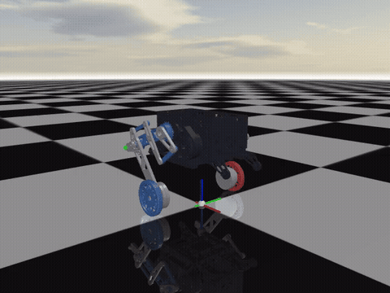
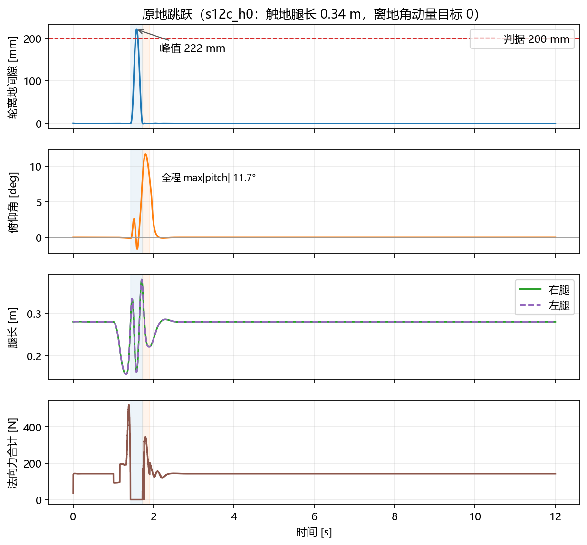

# GBC486 串联腿轮腿机器人仿真

MuJoCo 仿真项目，控制栈为 **8 状态降阶 MPC + 250 Hz WLS 全身控制（WBC）**，跳跃采用**双质量块规划**。机器人是 GBC486 构型：五连杆串联腿，每条腿两个髋部电机经双平行四边形驱动大腿和小腿，轮毂电机直驱轮子。



> 图中为原地跳跃：压缩、蹬伸、飞行、落地缓冲、恢复。完整视频见 [videos/serial_jump_50fps.mp4](videos/serial_jump_50fps.mp4)。

## 目录

- [项目概览](#项目概览)
- [控制架构](#控制架构)
- [快速开始](#快速开始)
- [测试工况](#测试工况)
- [目录结构](#目录结构)
- [文档](#文档)
- [已知限制](#已知限制)
- [许可证与致谢](#许可证与致谢)

## 项目概览

这个项目解决三件事：

1. **在 MuJoCo 里复现 GBC486 的闭链五连杆腿**，包括 4 个髋关节、2 个轮毂电机、8 条 connect 约束，以及可用的力/运动学接口。
2. **用分层控制完成平衡、速度跟踪、原地转向和跳跃**。上层 MPC 以 50 Hz 规划轮地力和共模腿角加速度，下层 WBC 以 250 Hz 把任务分配到 6 个执行器。
3. **把跳跃从“腿长/摆角”的差值规划改成两个质量块各自的运动规划**，从而管理起跳角动量、飞行段收伸腿和落地缓冲。

控制栈的关键选择：

| 项目 | 选择 | 原因 |
|---|---|---|
| MPC 模型 | 8 状态，含共模腿角与角速度 | 6 状态模型里腿角没有权限，减速只能靠轮子，腿始终贴着世界系零位 |
| MPC 输入 | 两轮纵向力 + 共模髋力矩 | 保留“用摆腿辅助加减速”的通道 |
| WBC 后端 | 限幅自洽 WLS | 严格优先级零空间法会把末级任务饿死；WLS 同时分配，且保证力矩与加速度一致 |
| 腿的建模 | 左右腿各自一套腿长/腿角任务 | 共模模型自由度不足，横滚和外部扰动收敛差 |
| 跳跃 | 两个质量块的状态 | 腿长、摆角是导出量，无法区分“轮子动了”还是“机体动了” |
| MPC 与跳跃 | 跳跃期断开 MPC，交给 WBC 计划任务 | MPC 基于标称腿长建模，压缩时会把腿长变化当成外部扰动 |

## 控制架构

```
                 50 Hz                          250 Hz                       1 kHz
      ┌───────────────────────┐      ┌──────────────────────────┐      ┌────────────────┐
      │  8 状态 MPC            │ ref  │  WLS WBC                 │ τ    │  MuJoCo        │
      │  x = [s, v, θ, θ̇,      │─────►│  4 条任务行               │─────►│  GBC486 模型   │
      │       ψ, ψ̇, δφ_c, δφ̇_c]│      │  6 条轮接触行             │      │  1 ms 步长     │
      │  u = [f_R, f_L, τ_c]   │      │  8 条闭链约束行           │      │                │
      └───────────────────────┘      │  4 条腿空间行             │      └────────────────┘
                                     └──────────────────────────┘
```

- **MPC（50 Hz，步长 20 ms，视界 25 步 = 0.5 s）**：以轮地纵向力 `f_R/f_L` 和共模髋力矩 `τ_c` 为输入，跟踪速度、偏航、俯仰与 ZMP 参考，并受轮力矩、髋力矩、摩擦与腿角范围约束。
- **WBC（250 Hz，4 ms）**：先消去接触力，把接触一致性等式与欠驱动动力学等式作为硬约束，再在零空间里按权重分配任务。任务优先级为 `pitch > 腿角 > 前进速度 > 腿长 > yaw > roll`，对应权重 `100 / 60 / 40 / 25 / 15 / 10`。
- **物理（1 kHz）**：MuJoCo `implicitfast` 积分器，闭链用 8 条 `connect` 约束表达。

更完整的推导见 [docs/mpc_wbc.md](docs/mpc_wbc.md)，代码与数据流见 [docs/architecture.md](docs/architecture.md)。

## 快速开始

环境要求：Python 3.10 及以上，Windows 或 Linux。项目在 Python 3.13.2 + MuJoCo 3.13.0 下验证。

```powershell
python -m venv .venv
.venv\Scripts\activate
python -m pip install -r requirements.txt
```

Linux / macOS 使用 `source .venv/bin/activate`。

### 交互仿真

```powershell
python tools/view.py
```

键盘：方向键上下控制速度，左右控制偏航，空格起跳，`R` 复位。默认使用 `leg_input`（8 状态）模型、`tuned-agile` preset 和 WLS 后端。

### 无界面诊断

```powershell
python tools/jump_diagnostic.py --stage T1 --case baseline --run-id demo `
  --duration 12.0 --jump-height 0.135 --jump-stroke 0.12 --jump-time 1.0 `
  --leg-length-compression --leg-length-thrust --flight-zero-torque `
  --flight-leg-retract --flight-leg-extend --flight-dual-mass `
  --two-mass-takeoff --mpc-nominal-normal --thrust-h-t 0.0
```

结果写入 `results/T1_baseline_demo.json.gz`，同目录下有日志。记录字段包括轮地间隙、法向力、两块质心状态、腿长、俯仰角、相位切换等。

### 录制视频

```powershell
python tools/video.py --tag demo --duration 4.0 --fps 50 `
  --camera tracking --camera-azimuth 140 --camera-distance 1.6 `
  --jump-height 0.135 --jump-time 1.0 `
  --leg-length-compression --leg-length-thrust --flight-zero-torque `
  --flight-leg-retract --flight-leg-extend --flight-dual-mass `
  --two-mass-takeoff --mpc-nominal-normal --thrust-h-t 0.0
```

输出到 `videos/demo_50fps.mp4`。视频按物理步取帧，时间轴与仿真时间一致。

## 测试工况

四个工况都用 640×480、50 fps、跟踪相机录制，参数与数据在 [docs/testing.md](docs/testing.md)。

| 工况 | 指令 | 关键结果 | 视频 |
|---|---|---|---|
| 前行 | 0 → 1.5 m/s，保持 3 s，随后停车 | 1.23 s 达到 1.45 m/s，稳态 1.50 m/s，4.0 s 停稳，里程 4.25 m，最大俯仰 0.08° | [mp4](videos/serial_forward_50fps.mp4) |
| 原地转圈 | 偏航 1.5 rad/s，保持 4.2 s | 实际偏航率峰值 1.536 rad/s，4.2 s 转过约 355°，纵向漂移 0.10 m，最大俯仰 0.002° | [mp4](videos/serial_spin_50fps.mp4) |
| 原地跳跃 | 目标质心抬升 0.135 m | 轮离地峰值 222 mm，落地收敛 0.936 s，全程 max\|pitch\| 11.7°，触地峰值法向力 347.8 N | [mp4](videos/serial_jump_50fps.mp4) |
| 前进 + 跳跃 | 1.0 m/s 指令，1.5 s 起跳 | 轮离地峰值 221 mm，全程 max\|pitch\| 11.3°，落地后 0.5 s 内速度回到 1.0 m/s，无零法向力帧 | [mp4](videos/serial_forward_jump_50fps.mp4) |



跳跃工况的三级判据（轮离地 ≥ 200 mm、落地收敛 ≤ 3.0 s、pitch 相对基线削弱）全部通过。基线为不带双质量块规划的 `base01`，触地 pitch −42.0°、全程 max|pitch| 45.5°；本方案触地 pitch +8.1°、全程 11.7°。

## 目录结构

```text
gbc486/
├── Algorithm/               控制算法库（本项目自带，不再依赖上层目录）
│   ├── mpc/                 8 状态降阶模型、QP、参考规划
│   ├── wbc/                 接触消去、零空间/加权求解器、SNS
│   ├── contact_state.py     接触与跳跃相位估计
│   └── supervision.py       模式监督与 WBC 反馈
├── gbc_mpc_wbc/             GBC486 适配层
│   ├── robot.py             模型加载、腿空间量、站立位形
│   ├── dynamics.py          选择矩阵、接触行、闭链行、腿空间行
│   ├── model_builder.py     6 / 8 状态降阶线性化
│   ├── wbc.py               任务集与权重
│   ├── wbc_limited.py       限幅自洽 WLS
│   ├── control.py           MPC/WBC 控制段
│   ├── loop.py              250 Hz / 50 Hz 调度与相位机
│   ├── simulation.py        闭环装配、配置、run()
│   ├── two_mass.py          两块模型、流形表、跳跃计划
│   ├── jump.py              相位机与起跳可行性
│   └── presets.py           MPC 参数档位
├── MJCF/                    GBC486 模型与网格
├── tools/                   查看器、诊断、录像、绘图、参数扫描
├── results/                 关键工况记录（json.gz + log）
├── docs/                    设计、调试、测试与学习文档
└── videos/                  四个测试工况的视频
```

## 文档

| 文档 | 内容 |
|---|---|
| [docs/architecture.md](docs/architecture.md) | 构型、状态定义、模块划分、单步数据流、代码地图 |
| [docs/mpc_wbc.md](docs/mpc_wbc.md) | 8 状态 MPC 推导、WBC 任务与 WLS、两层接口 |
| [docs/jump.md](docs/jump.md) | 双质量块模型、起跳/飞行/落地规划、实测结果 |
| [docs/debugging.md](docs/debugging.md) | 六个典型问题的现象、根因、修法与证据 |
| [docs/testing.md](docs/testing.md) | 四个工况的命令、指标、数据文件与复现步骤 |

## 已知限制

- 跳跃的三级判据只覆盖**原地竖直跳**。前进 + 跳跃已能完整跑通并录制，但没有纳入正式判据；侧向跳、连续跳未测试。
- 离地角动量实测与目标有约 12% 偏差（目标 0，实测 −0.026 kg·m²/s），触地 pitch 为 +8.1°（目标 0），交还后 MPC 需要约 0.7 s 回正。
- 跳跃期 MPC 断开，起跳和落地由 WBC 的计划任务接管。这是当前模型能力下的工程取舍；MPC 若要在压缩段继续工作，需要把腿长/腿角变化纳入建模。
- 6 状态 `held_leg` 模型作为对照保留，默认不使用。
- 质量、惯量和几何都来自 `MJCF/robot.xml`；改轮子或加配重后，两块质量和静平衡表需要重测。
- 结果数据来自本机 MuJoCo 3.13.0；不同 MuJoCo 版本可能有浮点级差异。

## 许可证与致谢

本项目采用 [PolyForm Noncommercial License 1.0.0](LICENSE)，仅限个人学习、学术研究与技术交流。

控制栈的早期版本来自 CirclegRobot 工作区；GBC486 的模型、适配层和跳跃方案在本项目中独立维护。跳跃四相位框架参考了《2023 基于非线性弹簧模型的轮腿自平衡机器人跳跃算法研究》，但本构型的力映射与规划方法按双质量块重新推导，没有沿用其弹簧刚度模型。
