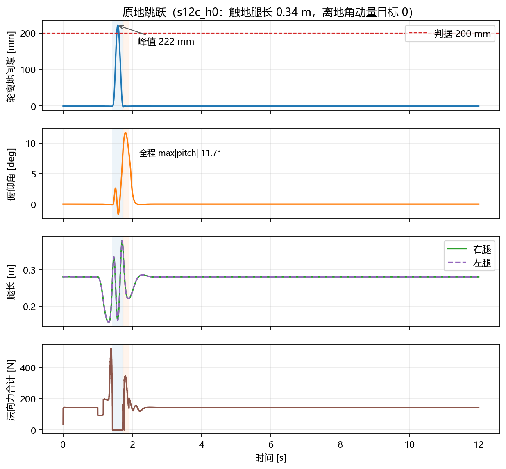

# 跳跃：双质量块规划

跳跃模块解决的核心问题是**起跳角动量**。早期方案直接规划腿长 `L` 和摆角 `φ`，起跳时接触点相对质心的水平位置随时间变化，法向力产生绕质心的力矩，机体在后仰方向积累角动量。触地时 pitch 达到 −42°，落地收敛慢，部分 run 直接发散。

把规划对象换成两个质量块各自的运动后，`L` 和 `φ` 变成导出量。起跳段可以在端点上直接给定离地角动量目标，飞行段由动量守恒约束两块的运动，落地段按质心竖向轨迹缓冲。本文说明这套方法的模型、计划、控制和实测结果。

## 1. 两块模型

### 1.1 质量划分

| 块 | 组成 | 质量 |
|---|---|---|
| 下块 `m1` | 两轮 + 小腿 GH/OP（含轮毂电机） | 3.924 kg |
| 上块 `m2` | 机体 + 其余连杆 | 10.622 kg |
| 整机 | | 14.546 kg |

质量比 `k = m1/m2 = 0.3694`，等效质量 `μ = m1·m2/(m1+m2) = 2.865 kg`。

### 1.2 耦合方程

两块之间只有腿力 `F`（内力，正方向为撑开）。取下块竖直方向：

```
m1·z1'' = N − m1·g − F
```

整理得法向力：

```
N = m1·(z1'' + g) + F
```

上块：

```
m2·z2'' = F·cosφ − m2·g
```

在小摆角下 `cosφ ≈ 1`，两块的关系可以写成：

```
F = m2·(z2'' + g) = −m1·(z1'' + g) = μ·L''
```

飞行段没有外力矩，总动量守恒：

```
m1·z1'' + m2·z2'' = −(m1+m2)·g
z2'' = −k·z1'' − (1+k)·g
```

### 1.3 离地条件

离地时 `N = 0`，且下块被地面钉住、`z1'' = 0`。代入法向力方程：

```
F = −m1·g = −38.5 N（两腿合计，单腿 −19.3 N）
```

也就是说，腿在离地瞬间必须处于**拉力**，大小等于下块自重。此时上块加速度：

```
z2'' = −(1+k)·g = −13.43 m/s²
```

这是从牛顿方程推出来的，不是人为设的阈值。代码里的离地核验就是检查这两个量，而不是看腿长有没有跨过某个数。

### 1.4 为什么不用弹簧刚度律

不需要拟合“腿像弹簧”的刚度（例如 `F = a(l0−l)³ + b(l0−l)`）。规划轨迹定了之后，力由逆动力学直接给出：

```
F(t) = −m1·(z1''(t) + g)
```

少一层拟合误差，代价是力依赖 `m1 / m2` 的准确性。换轮子或加配重后，两块质量要重测。

## 2. 三段计划

### 2.1 飞行段：只规划轮子的竖直轨迹

取归一化时间 `u = t/T`，形状函数：

```
f(u) = 64·u³·(1−u)³
f(0) = f(1) = 0
f'(0) = f'(1) = 0
f''(0) = f''(1) = 0
f(0.5) = 1
```

规划下块（轮子）的绝对高度：

```
z1(t) = h · f(u)
z2(t) = z2(0) + v0·t − (1+k)·g·t²/2 − k·z1(t)
L(t)  = z2(t) − z1(t)
F(t)  = −m1·(z1''(t) + g)
```

端点二阶导为 0，自动满足两个条件：

- `z1'(0) = z1'(T) = 0`：轮子在离地/触地时刻竖直速度为 0；
- `F(0) = F(T) = −m1·g`：两端都满足离地/触地条件。

**收腿和伸腿不是动作**，是同一条曲线的自然结果。`L(t)` 先升到约 0.34 m（伸），再降到 0.16 m（收），再回到落地腿长 0.34 m。规划里没有“收腿段”“伸腿段”这些状态，也没有相位切换。

`T` 和 `h` 由物理约束解出，不是调参量：

- `T`：触地时轮子回到地面（`z1 = 0`）且腿长等于落地腿长 `L_td`；
- `h`：要求腿长最小值等于收腿下限 `L_tuck = 0.16 m`。

典型解：`T ≈ 0.29–0.34 s`，`h ≈ 0.22–0.23 m`，`L ∈ [0.16, 0.34]`，计划峰值力约 188 N（单腿 94 N）。s12c_h0 的实际飞行时间是 0.293 s，轮离地峰值 222 mm。

### 2.2 起跳段：质心五次多项式

起跳段规划整机质心的竖直轨迹，用五次多项式连接入口实测状态和离地目标状态：

| 端点 | 条件 |
|---|---|
| 入口 | 质心位置、速度、加速度（实测） |
| 终点 | 质心位置 `D_td`（静平衡构型高度）、速度 `√(2g·h_target)`、加速度 `−g` |

`T` 在 `[0.085, 0.120] s` 内取“法向力峰值最小且全程 `N ≥ 0`、`zc' ≥ 0`”的值。s12c_h0 取 `T = 0.110 s`，`N` 峰 514 N。

水平方向与角动量：端点速度由动量方程解出：

```
[∂zc/∂L    ∂zc/∂φ  ] [L'(T)]   [zc'(T)]
[∂H/∂L'    ∂H/∂φ' ] [φ'(T)] = [H_t  ]
```

`H_t` 是离地角动量目标（设计输入，默认 −0.20，可配 `--thrust-h-t`）。`H_t` 越小，触地 pitch 越小，代价是 THRUST 段腿摆更快、离地后退速度更大。s12c_h0 用 `H_t = 0`。

两块相对水平位移 `Δx` 也用五次多项式规划，端点是静平衡流形上的 `Δx_eq`。

### 2.3 落地段：质心五次多项式

落地段从触地（`N = 0`）到静止：

| 端点 | 条件 |
|---|---|
| 起点 | 触地质心位置 `zc0`、速度 `vcz0`（实测）、加速度 `−g` |
| 终点 | 静止于 `D(L_end)`（`L_end = 0.22 m`），速度 = 加速度 = 0 |

`T` 在 `[0.060, 0.250] s` 内取“法向力峰值最小”的值。s12c_h0 取 `T = 0.179 s`，`N` 峰 347.8 N。

**触地构型**：计划触地腿长 `L_td = 0.34 m`，比站立腿长 0.28 m 多 0.06 m，作为落地缓冲行程；配合 `L_end = 0.22 m` 再压缩 0.12 m。触地后 0.2 s 窗口的法向力峰值从基线 547.5 N 降到 344.3 N。

### 2.4 三段统一

| 段 | 规划量 | 端点条件 | `T` 的求解 |
|---|---|---|---|
| 起跳 | 整机质心 `zc(t)`、两块 `Δx(t)` | 离地 `H = H_t`、构型回静平衡 | `N` 峰最小 |
| 飞行 | 下块轮子 `z1(t)` | 离地/触地 `N = 0`、腿长 = `L_td` | 物理约束解出 |
| 落地 | 整机质心 `zc(t)` | 终点静止于 `D(L_end)` | `N` 峰最小 |

`L` 和 `φ` 全部是导出量：

```
L(t) = z2(t) − z1(t)
φ(t) = 两块连线与竖直方向的夹角
```

## 3. 控制实现

### 3.1 相位机

```
IDLE → COMPRESS → COMPRESS_BRAKE → THRUST → FLIGHT → LANDING → IDLE
```

| 相位 | 触发 | 主要动作 |
|---|---|---|
| COMPRESS | 起跳指令 | 腿长从 0.28 压到 0.16 m，MPC 断开 |
| COMPRESS_BRAKE | 腿长到压缩终点 | 制动下压速度，等待 `L' ≈ 0` |
| THRUST | 制动完成 | 按两块计划蹬伸，WBC 跟踪 `com_z / dx_rel / L_d / phi_d` |
| FLIGHT | 计划时钟到点 + 法向力核验 | 按 `z1(t)` 出力矩，腿长 PD 跟踪 |
| LANDING | 几何接触恢复 | 按质心五次多项式缓冲，WBC 跟踪 `com_z` + pitch |
| IDLE | 落地计划终点 | 重新锚定 MPC/估计器，交还控制 |

相位日志会记录每次切换的时刻、腿长、间隙、姿态和核验结果。`phase_transition_assertion_failures` 统计核验失败次数，s12c_h0 为 0。

### 3.2 跳跃期为什么断开 MPC

MPC 的 8 状态模型是在标称腿长附近线性化的。压缩时腿长从 0.28 变到 0.16 m，模型的工作点已经变了。MPC 会把“腿长变化”解释成外部扰动，试图通过摆腿和轮力把它拉回标称构型，结果与压缩动作对抗，姿态发散。

当前工程取舍是：进入跳跃相位后不采信 MPC 轨迹（`sample = None`），起跳和落地由两块计划直接给 WBC 任务目标。这是模型能力不足下的权宜方案，不是理论上的正确做法。正确的修法是把腿长作为模型状态或调度变量，让 MPC 在压缩段仍然有效；这一步还没做。

### 3.3 飞行段：力位混合

飞行段没有接触，直接出力矩：

```
F_cmd = F_plan(t) + 3000·(L_ref − L) + 150·(v_ref − L')
τ = Jᵀ · [F_cmd/2, F_φ]
```

`3000 / 150` 是既有增益，没有改。跟踪项必须保留：纯前馈时约 15% 的模型误差（静力学映射忽略杆件惯量）会积分成 68 mm 的腿长漂移。

### 3.4 起跳 / 落地段：WBC 任务

起跳和落地仍走 WBC，但任务从“腿长 / 摆角”换成两块物理量：

| 段 | WBC 任务 |
|---|---|
| THRUST | `com_z`（整机质心竖直）、`dx_rel`（两块相对水平）、`L_d`（差模腿长）、`φ_d`（差模腿角） |
| LANDING | 同上 + `pitch` |

`com_z` 用整机质心的竖直雅可比，`dx_rel` 用两块质心的水平差雅可比。任务权重沿用被替代任务的权重：`com_z / dx_rel` 取 25，`L_d / φ_d` 取 60。

## 4. 实测结果

### 4.1 s12c_h0

运行条件：`--jump-height 0.135 --jump-stroke 0.12 --jump-time 1.0`，`--leg-length-compression --leg-length-thrust --flight-zero-torque --flight-leg-retract --flight-leg-extend --flight-dual-mass --two-mass-takeoff --mpc-nominal-normal --thrust-h-t 0.0`，时长 12 s。

| 级 | 判据 | 结果 |
|---|---|---|
| 第 1 级：跳跃功能 | 轮离地峰 ≥ 0.200 m、离地竖速 ∈ [1.546, 1.708]、无 ABORT、力矩不饱和、腿长合法 | 通过（0.222 m、1.642 m/s、0 次 ABORT、髋 21.7 / 轮 0.81 N·m、L ∈ [0.156, 0.379]） |
| 第 2 级：落地收敛 | `T_max ≤ 3.0 s` | 通过（0.666 s，判据见 [testing.md](testing.md)） |
| 第 3 级：pitch 削弱 | 触地 \|pitch\| < 0.5394、全程 max\|pitch\| < 0.5916 | 通过（0.1406、0.2041 rad） |

### 4.2 与基线对比

| 指标 | 基线（无规划） | 本方案 | 变化 |
|---|---|---|---|
| 触地 pitch | −0.733 rad（−42.0°） | +0.141 rad（+8.1°） | 幅值降 81% |
| 全程 max\|pitch\| | 0.795 rad（45.5°） | 0.204 rad（11.7°） | 降 74% |
| 触地俯仰角速度 | −1.414 rad/s | +1.775 rad/s | 方向相反，落地后由 MPC 回正 |
| 触地后 0.2 s 法向力峰值 | 547.5 N | 344.3 N | 降 37% |
| 落地后稳态时间 | 0.489 s | 0.666 s | 慢 0.18 s |

pitch 与落地冲击的改善明显，代价是落地后进入稳态的时间略长。稳态判据是 `|pitch| ≤ 0.05 rad`、`|pitch_rate| ≤ 0.2 rad/s`、`|vx| ≤ 0.1 m/s` 连续保持 0.3 s。



### 4.3 角动量分配

`H_t = 0` 时：

| 时刻 | `H`（kg·m²/s） | 说明 |
|---|---|---|
| 离地 | −0.026 | 目标 0，偏差约 12% |
| 飞行 | −0.025 → −0.025 | 守恒自检通过（变化 0.002） |
| 触地 | — | 机体占比低，pitch' 接近 0 |

角动量没有被“消除”，只是在机体旋转和腿摆动之间重新分配。飞行段 `H` 守恒，能改的是分配比例。要降低触地 pitch，就在起跳端点把 `H_t` 设小。

## 5. 和原方案的区别

| 维度 | 原方案 | 本方案 |
|---|---|---|
| 规划对象 | 腿长 `L`、摆角 `φ` | 两块各自的位移、速度、角速度 |
| 收腿/伸腿 | 显式规划“何时收、收多少” | 曲线的自然结果，无状态切换 |
| 离地判据 | 几何阈值（腿长、间隙） | 物理条件（`N = 0`，由牛顿方程推出） |
| 角动量 | 不主动管理 | 起跳端点设 `H_t`，飞行守恒，落地规划 |
| 触地构型 | 站立腿长 0.28 m | 计划 0.34 m，留缓冲行程 |
| 落地缓冲 | WBC 腿长任务（无计划） | 质心五次多项式，终点 `L_end = 0.22 m` |

## 6. 局限

1. **`H_t` 偏差约 12%**。目标 0，实测离地 −0.026，触地 pitch 为 +8.1°（目标 0）。来源未定位。交还后 MPC 需要约 0.7 s 把它收回 0。
2. **离地后退速度**。`H_t` 越小，离地 `vx` 越负（`H_t = 0` 时约 −0.31 m/s）。落地段的水平速度计划还没做，交还时 `vx` 由 MPC 刹车。
3. **只验证了竖直跳**。侧向跳、带速度指令的跳跃没有纳入正式判据；前进 + 跳跃已能跑通，见 [testing.md](testing.md)。
4. **质量参数依赖 MJCF**。换轮、加配重必须重测 `m1 / m2` 和静平衡表。
5. **飞行段腿角跟踪**。`KP_PHI = 20.9` 在 1.69 rad/s 的摆速下正常，更高速度未测试。
6. **跳跃期 MPC 断开**。这是当前模型能力下的取舍，不代表 MPC 在压缩段无法工作；需要把腿长纳入建模后再评估。
