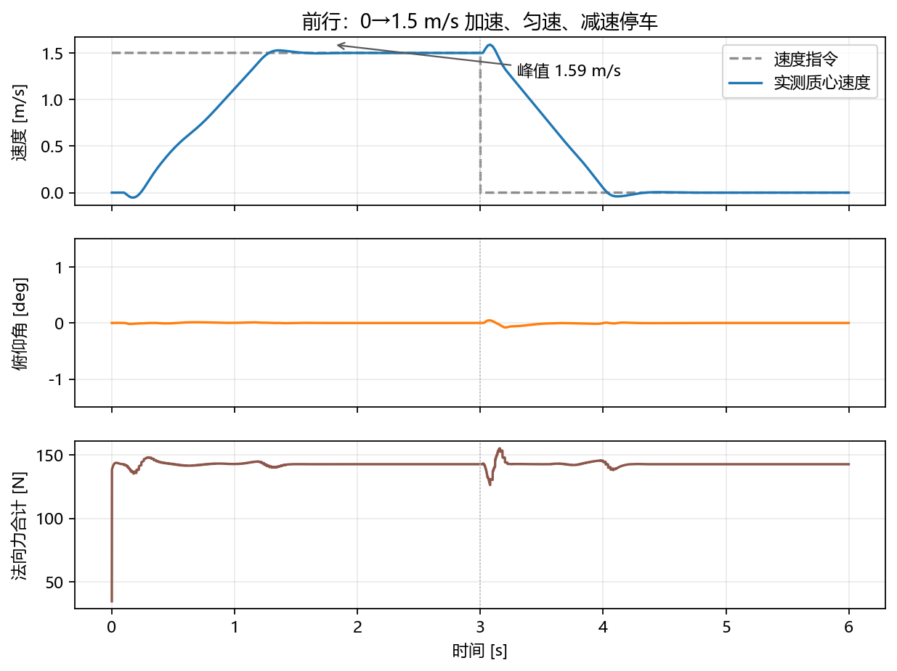
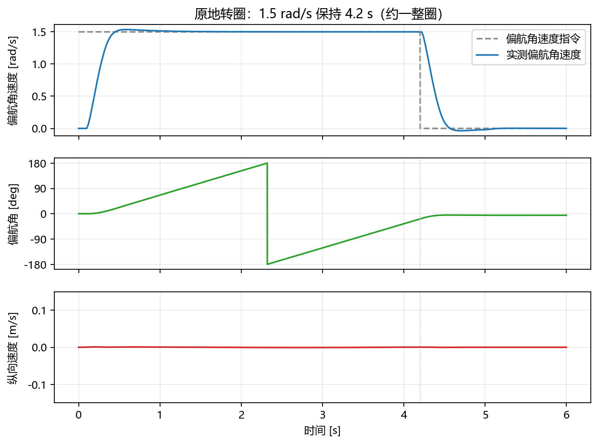
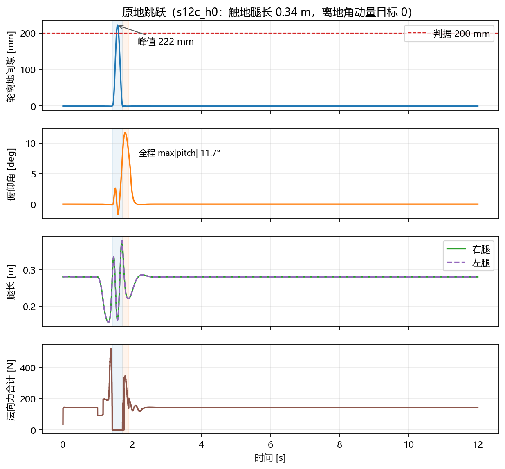
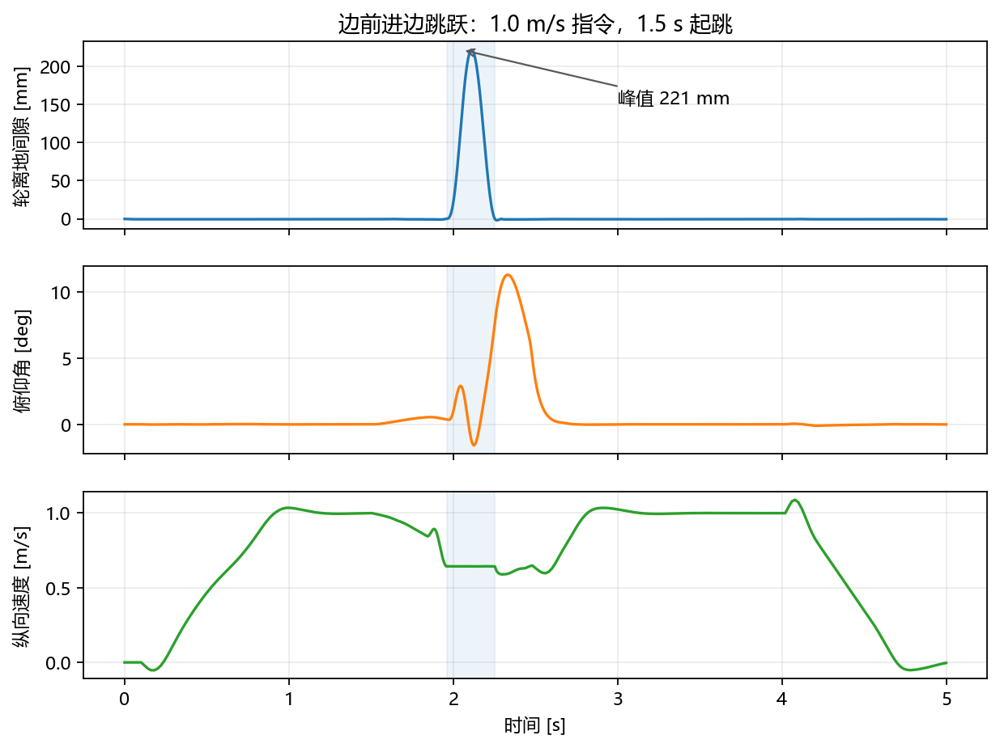

# 测试与复现

本文记录四个测试工况的条件、指标、数据文件和视频生成命令。所有数据来自本机 MuJoCo 3.13.0、Python 3.13.2，物理步长 1 ms，WBC 250 Hz，MPC 50 Hz。

## 1. 测试范围

| 工况 | 目的 | 判据 |
|---|---|---|
| 前行 | 速度跟踪、加速/减速、姿态保持 | 稳态速度接近指令；最大俯仰小；能停稳 |
| 原地转圈 | 偏航跟踪、原地转向 | 偏航率接近指令；纵向漂移小；姿态保持 |
| 原地跳跃 | 跳跃功能、落地收敛、pitch 削弱 | 三级判据，见第 4 节 |
| 前进 + 跳跃 | 带速度的跳跃 | 能完整起跳/落地；无零法向力连续帧；落地后能继续跟踪速度 |

跳跃的三级判据是正式判据。前行、转圈、前进 + 跳跃目前是功能验证，没有设置和跳跃同等级的通过线；本文给出实测值，供后续对比。

## 2. 通用设置

- 视频：640×480、50 fps、跟踪相机（`azimuth 140°`、`distance 1.6 m`、`elevation −12°`）。
- 控制：`leg_input`（8 状态）、`tuned-agile` preset、WLS 后端。
- 跳跃：目标质心抬升 0.135 m、压缩行程 0.12 m，双质量块计划全开。
- 每组数据记录到 `results/T1_<case>_<run-id>.json.gz`，同目录有 `.log`。

## 3. 前行

### 3.1 条件

速度指令 1.5 m/s，保持 3.0 s，之后归零，总时长 6.0 s。

```powershell
python tools/jump_diagnostic.py --stage T1 --case command_velocity --run-id forward_ref `
  --duration 6.0 --no-jump --command-velocity 1.5 --command-hold 3.0
```

视频：

```powershell
python tools/video.py --tag serial_forward --duration 6.0 --fps 50 --push-time -1 `
  --camera tracking --camera-azimuth 140 --camera-distance 1.6 --camera-elevation -12 `
  --command-velocity 1.5 --command-hold 3.0
```

### 3.2 结果

| 指标 | 值 |
|---|---|
| 达到 1.45 m/s 的时刻 | 1.23 s |
| 3.0 s 时速度 | 1.499 m/s |
| 质心速度峰值 | 1.59 m/s（制动切换瞬间） |
| 停稳时刻（速度 ≤ 0.05 m/s） | 4.00 s |
| 总里程 | 4.249 m |
| 全程 max\|pitch\| | 0.0014 rad（0.08°） |
| 最大俯仰角速度 | 0.032 rad/s |
| 最大髋力矩 / 轮力矩 | 8.9 / 1.67 N·m |



速度稳态误差小于 0.5%，制动切换时有约 6% 的短时过冲，随后在 0.2 s 内回落。全程俯仰小于 0.1°，没有触发姿态保护。

## 4. 原地转圈

### 4.1 条件

偏航角速度指令 1.5 rad/s，保持 4.2 s，之后归零，总时长 6.0 s。

```powershell
python tools/jump_diagnostic.py --stage T1 --case command_velocity --run-id spin_ref `
  --duration 6.0 --no-jump --command-velocity 0.0 `
  --command-yaw-rate 1.5 --command-yaw-hold 4.2
```

视频：

```powershell
python tools/video.py --tag serial_spin --duration 6.0 --fps 50 --push-time -1 `
  --camera tracking --camera-azimuth 140 --camera-distance 1.6 --camera-elevation -12 `
  --command-yaw-rate 1.5 --command-yaw-hold 4.2
```

### 4.2 结果

| 指标 | 值 |
|---|---|
| 实测偏航角速度峰值 | 1.536 rad/s |
| 稳态偏航角速度 | 约 1.50 rad/s |
| 4.2 s 内转过的角度 | 约 353°（接近一整圈，偏航角在 ±180° 处回绕） |
| 纵向漂移 | 0.097 m |
| 最大纵向速度 | 0.073 m/s |
| 全程 max\|pitch\| | 0.00004 rad（0.002°） |
| 最大髋力矩 / 轮力矩 | 8.63 / 0.51 N·m |



偏航角在 4.2 s 时接近 −180° 回绕点，所以图上出现一次跳变；实际连续转角约 353°。原地转圈的纵向漂移约 0.1 m，来自两轮摩擦和腿长不对称，后续可以通过差模腿长任务进一步压低。

## 5. 原地跳跃

### 5.1 条件

跳跃指令在 1.0 s 触发，目标质心抬升 0.135 m，压缩行程 0.12 m，时长 12.0 s（包含落地后的恢复段）。

```powershell
python tools/jump_diagnostic.py --stage T1 --case baseline --run-id s12c_h0 `
  --duration 12.0 --jump-height 0.135 --jump-stroke 0.12 --jump-time 1.0 `
  --leg-length-compression --leg-length-thrust --flight-zero-torque `
  --flight-leg-retract --flight-leg-extend --flight-dual-mass `
  --two-mass-takeoff --mpc-nominal-normal --thrust-h-t 0.0
```

视频（4 s 版本）：

```powershell
python tools/video.py --tag serial_jump --duration 4.0 --fps 50 --push-time -1 `
  --camera tracking --camera-azimuth 140 --camera-distance 1.6 --camera-elevation -12 `
  --jump-height 0.135 --jump-stroke 0.12 --jump-time 1.0 `
  --leg-length-compression --leg-length-thrust --flight-zero-torque `
  --flight-leg-retract --flight-leg-extend --flight-dual-mass `
  --two-mass-takeoff --mpc-nominal-normal --thrust-h-t 0.0
```

### 5.2 结果

| 指标 | 判据 | 实测 |
|---|---|---|
| 轮离地峰值 | ≥ 0.200 m | 0.222 m |
| 离地竖直速度 | ∈ [1.546, 1.708] m/s | 1.642 m/s |
| ABORT | 0 次 | 0 次 |
| 髋力矩峰值 | ≤ 40 N·m | 28.5 N·m |
| 轮力矩峰值 | ≤ 4.0 N·m | 3.04 N·m |
| 腿长范围 | 机构范围内 | 0.156–0.379 m |
| 落地后稳态时间 | ≤ 3.0 s | 0.666 s |
| 触地 \|pitch\| | < 0.5394 rad | 0.1406 rad（8.1°） |
| 全程 max\|pitch\| | < 0.5916 rad | 0.2041 rad（11.7°） |
| 触地后 0.2 s 法向力峰值 | — | 344.3 N（落地计划 N 峰 347.8 N） |

落地稳态判据：触地后 `|pitch| ≤ 0.05 rad`、`|pitch_rate| ≤ 0.2 rad/s`、`|vx| ≤ 0.1 m/s`，连续保持 0.3 s。基线 `base01` 在同一判据下为 0.489 s。

相位帧数（1 ms/帧）：

```
COMPRESS 157 / COMPRESS_BRAKE 159 / THRUST 113 / FLIGHT 293 / LANDING 181 / IDLE 11097
```

相位切换核验失败 0 次。



## 6. 前进 + 跳跃

### 6.1 条件

速度指令 1.0 m/s，保持 4.0 s；1.5 s 触发跳跃；总时长 5.0 s。

```powershell
python tools/jump_diagnostic.py --stage T1 --case command_velocity --run-id forward_jump_ref `
  --duration 5.0 --jump-height 0.135 --jump-stroke 0.12 --jump-time 1.5 `
  --command-velocity 1.0 --command-hold 4.0 `
  --leg-length-compression --leg-length-thrust --flight-zero-torque `
  --flight-leg-retract --flight-leg-extend --flight-dual-mass `
  --two-mass-takeoff --mpc-nominal-normal --thrust-h-t 0.0
```

视频：

```powershell
python tools/video.py --tag serial_forward_jump --duration 5.0 --fps 50 --push-time -1 `
  --camera tracking --camera-azimuth 140 --camera-distance 1.6 --camera-elevation -12 `
  --command-velocity 1.0 --command-hold 4.0 `
  --jump-height 0.135 --jump-stroke 0.12 --jump-time 1.5 `
  --leg-length-compression --leg-length-thrust --flight-zero-torque `
  --flight-leg-retract --flight-leg-extend --flight-dual-mass `
  --two-mass-takeoff --mpc-nominal-normal --thrust-h-t 0.0
```

### 6.2 结果

| 指标 | 值 |
|---|---|
| 轮离地峰值 | 0.221 m |
| 全程 max\|pitch\| | 0.197 rad（11.3°） |
| 总里程 | 3.543 m |
| 起跳前速度 | 约 1.0 m/s |
| 飞行段速度低点 | 约 0.59 m/s |
| 落地后回到 1.0 m/s | 0.5 s 内 |
| 落地后零法向力连续帧 | 0 |
| ABORT | 0 次 |
| 相位核验失败 | 0 次 |



飞行段速度下降是正常的：跳跃把部分纵向动量转成了竖向动量。落地后 MPC 接管，0.5 s 内速度回到 1.0 m/s，随后在 4.0 s 减速停车。

## 7. 回归基线

代码重构或参数改动后，先跑不传新开关的回归。s12c_h0 的关键 summary：

```
max_positive_wheel_gap_m = 0.22216630273035431
max_abs_pitch_rad        = 0.20407684769328654
max_abs_pitch_rate_rad_s = 1.8529855914088074
phase_frame_counts       = COMPRESS 157 / COMPRESS_BRAKE 159 / THRUST 113 /
                           FLIGHT 293 / LANDING 181 / IDLE 11097
phase_transition_assertion_failures = 0
```

本次把 `Algorithm/` 复制进 `gbc486/`、去掉对上层 `sys.path` 的依赖后，这组数值逐项一致，逐帧记录未重跑对比（`qpos` 对比需要旧工作区的数据）。控制行为没有变化。

## 8. 数据文件

| 文件 | 内容 |
|---|---|
| `results/T1_command_velocity_forward_ref.json.gz` | 前行 6 s |
| `results/T1_command_velocity_spin_ref.json.gz` | 原地转圈 6 s |
| `results/T1_baseline_s12c_h0.json.gz` | 原地跳跃 12 s（最终方案） |
| `results/T1_command_velocity_forward_jump_ref.json.gz` | 前进 + 跳跃 5 s |
| `results/T1_baseline_base01.json.gz` | 跳跃基线 |
| `results/T1_baseline_s1pd.json.gz` | 飞行段双质量块基线 |
| `results/T1_baseline_s10_on.json.gz` | 起跳 + 飞行 + 落地计划 |
| `results/T1_baseline_s11a_on.json.gz` | 加 MPC 名义法向力 |

每个 `.json.gz` 的字段包括：`t`、`qpos`、`qvel`、`ctrl`、`pitch`、`pitch_rate`、`yaw`、`yaw_rate`、`leg_state`（`[L_R, φ_R, L_L, φ_L]`）、`leg_length_L/R`、`com_xz`、`com_vxz`、`normal_forces`、`tangent_forces`、`wheel_gap`、`wheel_points`、`contact_geometry`、`contact_estimator`、`decision`、`jump`、`phase_transition`、`output_source` 等。

## 9. 生成图表

```powershell
python tools/make_figures.py
```

读取上面四个工况，输出到 `docs/images/`：

- `jump_two_mass.png`
- `forward_speed.png`
- `spin_yaw.png`
- `forward_jump.png`

绘图只做可视化，不参与控制。所有曲线的字段与 `jump_diagnostic.py` 的记录口径一致。

## 10. 已知限制

- 跳跃判据只覆盖原地竖直跳；前进 + 跳跃是功能验证，没有正式通过线。
- 侧向跳、连续跳、斜坡跳未测试。
- 原地方向的纵向漂移约 0.1 m，来自两轮摩擦与腿长不对称。
- 结果依赖 MJCF 的质量和几何；换模型后需要重测两块质量和静平衡表。
- MuJoCo 版本不同可能有浮点级差异；跨版本比较时先跑同一工况的回归。
